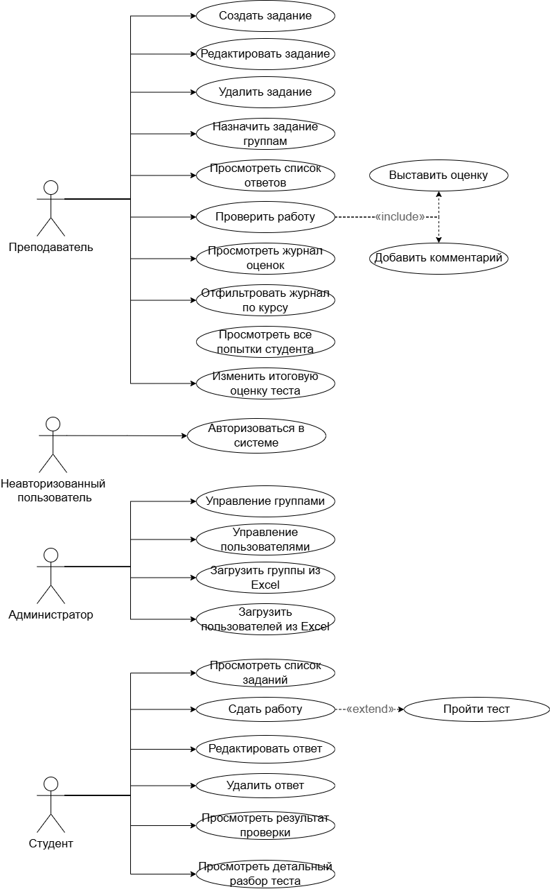
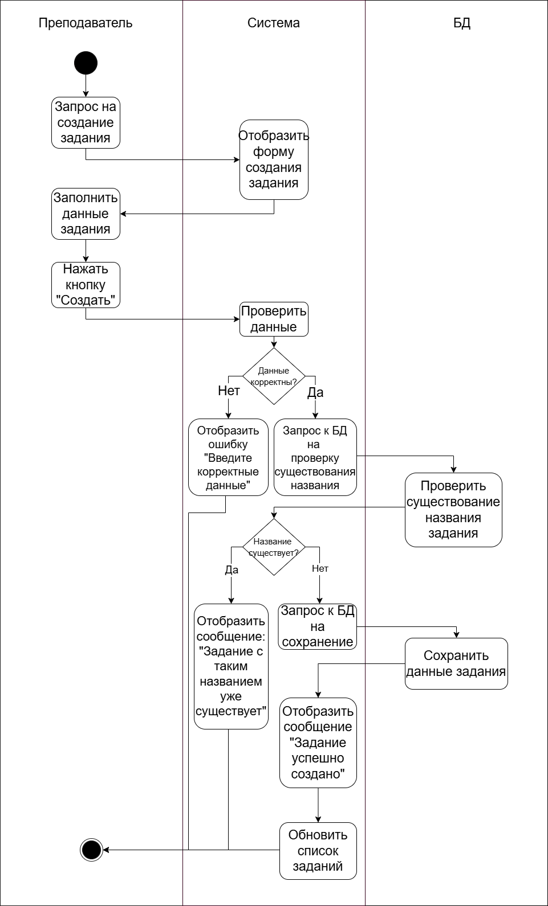
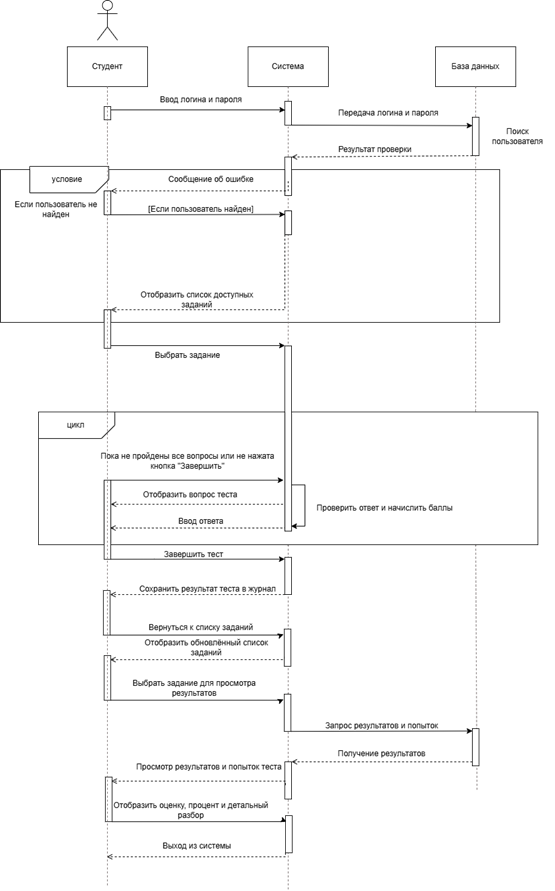

# Проектирование системы

В этом разделе собраны ключевые артефакты проектирования информационной системы.

## 1. Диаграмма вариантов использования (Use Case)

Отражает функциональные границы системы и роли пользователей. 
На диаграмме выделены три основные роли: **Преподаватель**, **Студент** и **Администратор**, а также неавторизованный пользователь.

**Ключевые сценарии:**
* *Преподаватель:* создание и редактирование заданий, проверка работ, выставление оценок, просмотр журнала.
* *Студент:* просмотр заданий, сдача работ, прохождение тестов, просмотр результатов.
* *Администратор:* управление группами и пользователями, массовая загрузка данных из Excel.

## 2. Диаграмма активности (Activity)

Моделирует пошаговый процесс создания нового задания преподавателем. 
Диаграмма отражает валидацию данных, проверку на дубликаты названий в базе данных и логику сохранения задания.

## 3. Диаграмма последовательности (Sequence)

Описывает сценарий «Авторизация и сдача теста студентом». 
Диаграмма показывает взаимодействие между объектами во времени: ввод логина и пароля, проверка данных в БД, отображение доступных заданий, цикл прохождения вопросов теста, автоматическую проверку ответов, сохранение результата и просмотр детального разбора.

