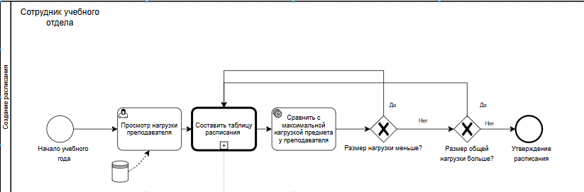
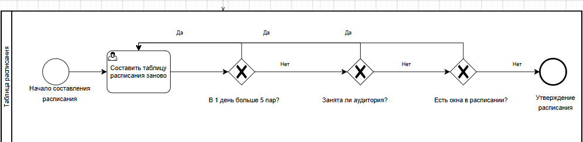

# BPMN-диаграммы процессов

В данном разделе представлены диаграммы бизнес-процессов, построенные в нотации BPMN. Они описывают логику создания и валидации расписания занятий.

## Процесс создания расписания

Данный процесс начинается с события «Начало учебного года». Сотрудник учебного отдела просматривает текущую нагрузку преподавателей. Система последовательно выполняет проверки: сравнивает планируемую нагрузку с максимально допустимой и оценивает, не превышает ли общая нагрузка установленный лимит. Если какая-либо из проверок не пройдена, управление возвращается к этапу просмотра нагрузки. При успешном прохождении всех проверок система составляет таблицу расписания, которая затем утверждается.

## Процесс валидации таблицы расписания

Данный процесс включает проверку на превышение количества пар в один день (не более пяти пар). При обнаружении нарушений (например, занятость аудитории, наличие «окон» или превышение лимита пар) расписание формируется заново. Утверждённое расписание становится доступным для всех пользователей.

