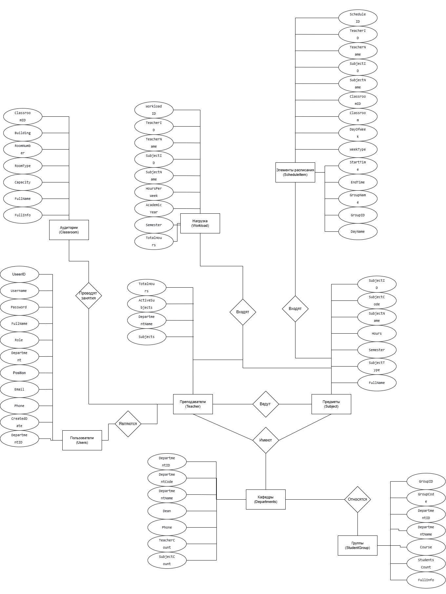
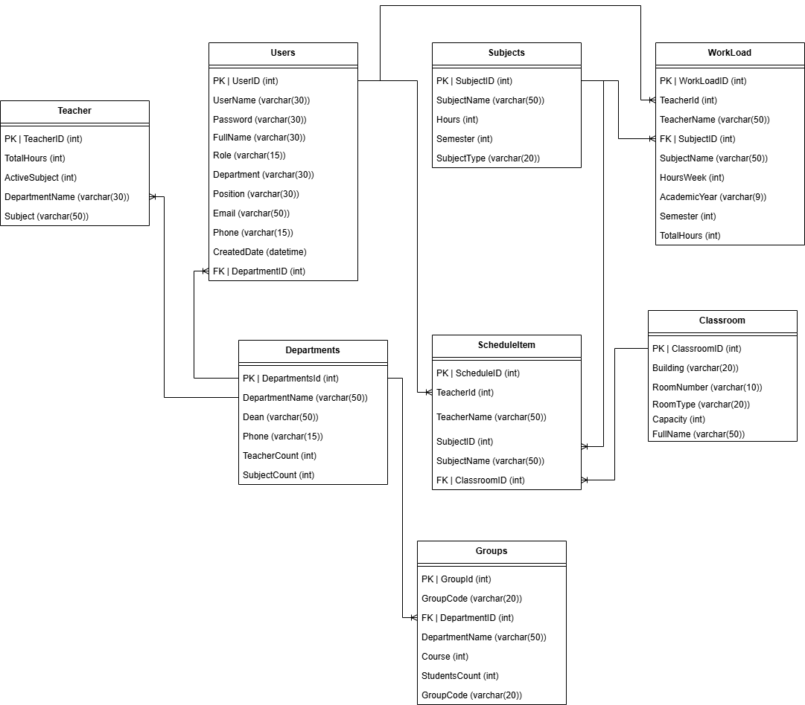

# Модели данных (База данных)

Проектирование базы данных выполнено в три этапа: концептуальное, логическое и физическое моделирование.

## Концептуальная модель
Определяет основные сущности предметной области («Преподаватель», «Учебная группа», «Расписание», «Пользователи») и типы связей между ними (один-ко-многим, многие-ко-многим) без привязки к конкретной СУБД.

## Логическая модель
Детализирует концептуальную модель, добавляя атрибуты для каждой сущности, определение первичных и внешних ключей, а также типов данных. Например, для сущности «Преподаватель» определяются атрибуты: ФИО, перечень дисциплин, максимальная и текущая нагрузка.

## Физическая модель
Отражает конкретную реализацию базы данных в СУБД SQLite с указанием точных имен таблиц, полей, типов данных и ограничений целостности (уникальность полей, внешние ключи с каскадным удалением).

