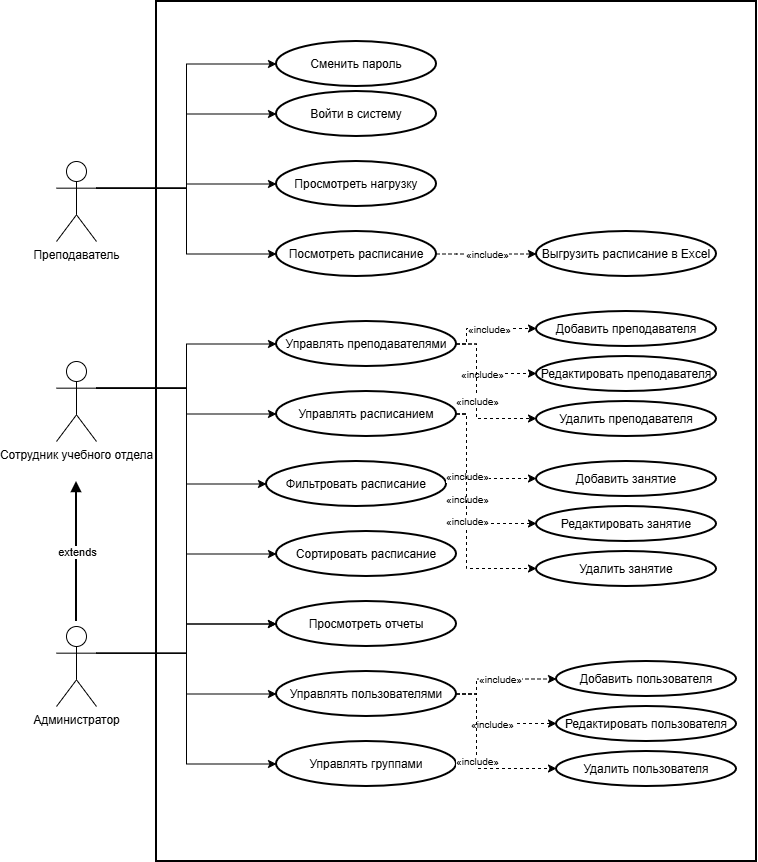
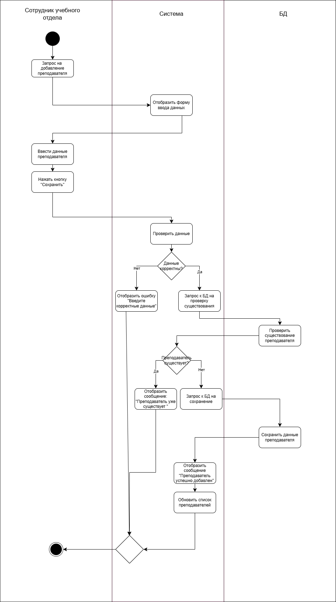
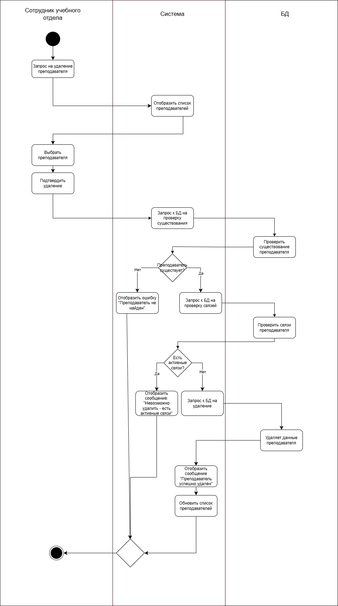

# UML-диаграммы

В данном разделе представлены диаграммы, описывающие функциональные требования и логику работы системы с использованием нотации UML.

## Диаграмма вариантов использования (Use Case)

Диаграмма отображает функциональные границы системы и роли пользователей. Акторами системы являются: «Преподаватель», «Сотрудник учебного отдела» и «Администратор». 
* **Преподаватель** имеет доступ к просмотру своей нагрузки и расписания, а также к выгрузке расписания в Excel.
* **Сотрудник учебного отдела** управляет профилями преподавателей и расписанием занятий.
* **Администратор** управляет пользователями системы и назначает роли.

## Диаграмма активности: Добавление преподавателя

Процесс описывает шаги добавления нового преподавателя сотрудником учебного отдела. Система проверяет корректность введенных данных (валидация), проверяет наличие дубликатов в базе данных и, в случае успеха, сохраняет запись и обновляет список.

## Диаграмма активности: Удаление преподавателя

Процесс описывает удаление преподавателя. Система проверяет существование записи, а также наличие связанных данных (например, занятий в расписании). Если связей нет, запись удаляется из базы.

