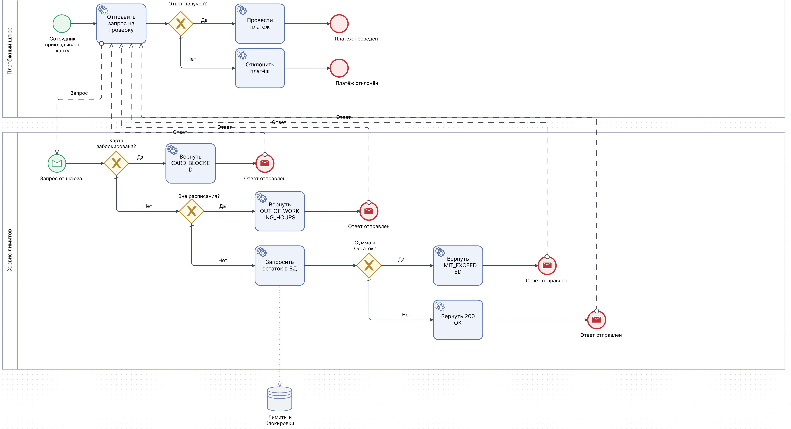

# BPMN-диаграмма процесса проверки платежа

В данном разделе представлена диаграмма бизнес-процесса, построенная в нотации BPMN 2.0 в StormBPMN. Она описывает логику проверки платежа на соответствие лимитам и блокировкам.

## Участники процесса (Пулы)
1. **Платежный шлюз** - внешняя система, которая инициирует запрос на проверку.
2. **Сервис лимитов** - наш сервис, который проверяет правила.
3. **База данных** - хранилище лимитов и блокировок.

## Логика процесса
1. Сотрудник прикладывает карту в магазине.
2. Платежный шлюз отправляет запрос в Сервис лимитов: «Можно ли провести транзакцию?».
3. Сервис лимитов проверяет:
   * Не заблокирована ли карта? (Если да - возвращает `CARD_BLOCKED`).
   * Не выходит ли время за рамки расписания? (Если да - возвращает `OUT_OF_WORKING_HOURS`).
   * Не превышает ли сумма остаток лимита? (Если да - возвращает `LIMIT_EXCEEDED`).
4. Если все проверки пройдены - возвращает `200 OK` (Разрешено).
5. Платежный шлюз проводит платеж.

## Схема процесса

