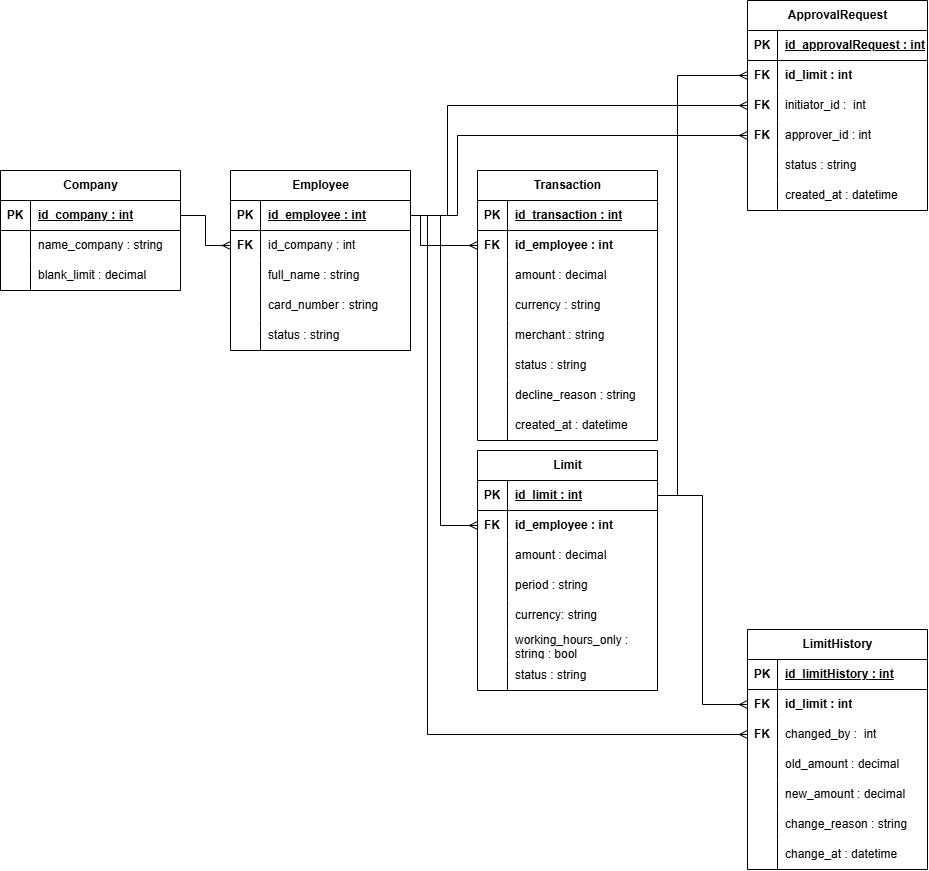

# Модель данных (ER-диаграмма)

В данном разделе представлена логическая модель данных, спроектированная для сервиса управления лимитами. Модель состоит из 6 таблиц и реализована в нотации Crow's Foot (ER-диаграмма).

## Сущности и связи

**1. Компания (Company)**
* `id_company` (PK) - уникальный идентификатор компании.
* `name_company` - название.
* `bank_limit` - максимальный лимит, установленный банком.

**2. Сотрудник (Employee)**
* `id_employee` (PK) - уникальный идентификатор.
* `id_company` (FK) - ссылка на компанию.
* `full_name` - ФИО.
* `card_number` - номер карты.
* `status` - статус (ACTIVE, BLOCKED).

**3. Лимит (Limit)**
* `id_limit` (PK) - уникальный идентификатор.
* `id_employee` (FK) - ссылка на сотрудника.
* `amount` — сумма лимита.
* `period` - период (DAY, MONTH).
* `currency` - валюта (RUB, USD, EUR).
* `working_hours_only` - флаг (действует ли только в рабочее время).
* `status` - статус (ACTIVE, PENDING_APPROVAL, REJECTED).

**4. Транзакция (Transaction)**
* `id_transaction` (PK) - уникальный идентификатор.
* `id_employee` (FK) - кто потратил.
* `amount` - сумма.
* `currency` - валюта.
* `merchant` - место покупки.
* `status` - статус (SUCCESS, DECLINED).
* `decline_reason` - причина отказа.
* `created_at` - дата и время.

**5. Заявка на подтверждение (ApprovalRequest)**
* `id_approvalRequest` (PK) - уникальный идентификатор.
* `id_limit` (FK) - ссылка на лимит.
* `initiator_id` (FK) - кто создал заявку.
* `approver_id` (FK) - кто должен подтвердить.
* `status` - статус (PENDING, APPROVED, REJECTED).
* `created_at` - дата создания.

**6. История изменений лимитов (LimitHistory)**
* `id_limitHistory` (PK) - уникальный идентификатор.
* `id_limit` (FK) - ссылка на лимит.
* `changed_by` (FK) - кто изменил.
* `old_amount` - старая сумма.
* `new_amount` - новая сумма.
* `change_reason` - причина.
* `changed_at` - дата и время.

## Схема базы данных

